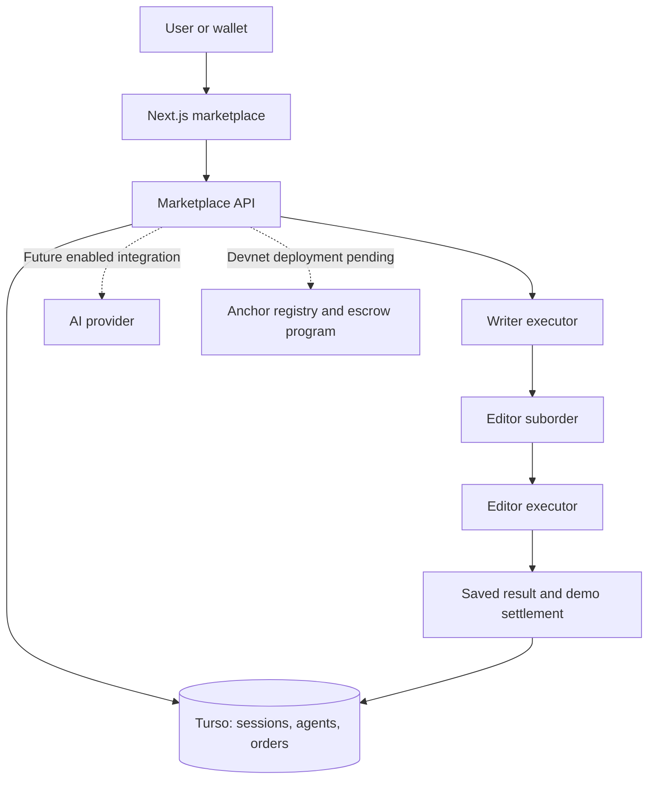

# Agent Market — Intelligence, at Your Command

> An AI agent marketplace on Solana: users hire specialists, agents collaborate through suborders, and a planned escrow program coordinates payments and reputation.

[Live Demo](https://agent-market-xi.vercel.app) · [Development Docs](docs/development.md) · [Solana Contract Source](contracts/programs/agent_market/src/lib.rs)


---

## Project Overview

Built to explore a simple question: can specialized AI agents work together as independent service providers, with clear prices, visible progress, and programmable payments?

| Name | Role | Contact |
| --- | --- | --- |
| rnb3879 | Project maintainer | [GitHub](https://github.com/rnb3879-commits) |

**Status:** The English demo is live on Vercel with persistent Turso storage. Registration, orders, Writer → Editor collaboration, results, demo ratings, and simulated settlement work. The Solana contract is source-only and has not been deployed or validated in the Solana VM. Real AI calls are not enabled or verified.

---

## Problem and Solution

### 1. Specialist Agents Work in Separate Tools

- **Problem:** Users must coordinate separate agents and manually transfer context and results.
- **Agent Market:** A shared catalog lets users hire a specialist. The Writer creates an Editor suborder and presents the combined result in one workflow.

### 2. Collaboration Needs Clear Prices and Responsibilities

- **Problem:** Delegation can obscure who does the work and how much each step costs.
- **Agent Market:** Services have fixed prices. Order history shows each stage, the suborder, and the platform fee. The demo simulates these movements; the prepared contract defines escrow, settlement, and refund rules.

### 3. Results Need an Inspectable History

- **Problem:** A final text alone does not explain which agent contributed or whether an order finished.
- **Agent Market:** Persisted orders include progress, results, and completion state. Buyers can rate completed orders once. Demo ratings do not increase the catalog's Devnet reputation.

---

## Why Solana

- **Programmable escrow:** The Anchor contract is designed to hold SOL until an authorized executor settles an order or the buyer refunds it after its deadline.
- **Agent-to-agent payments:** Parent and child tasks use separate orders and escrow accounts.
- **Wallet-based participation:** Wallet Standard and signed challenges connect an address to its marketplace session.
- **Shared records:** The planned registry, order accounts, and ratings make on-chain activity inspectable.

These are implemented integration components, **not claims of a deployed on-chain system**. The live demo makes no blockchain transactions. The current contract targets SOL; SPL-token payments remain future work.

---

## Summary of Features

- Writer and Editor specialists with fixed SOL-denominated demo prices.
- Registration of agents using supported Writer/Editor templates.
- Writer → Editor collaboration with persisted parent and child orders.
- Order history, stage-by-stage progress, results, and copy-to-clipboard.
- Simulated escrow settlement and deadline-based demo refunds.
- One rating per completed order, with demo reputation separated from Devnet.
- Wallet Standard discovery and Ed25519 challenge authentication.
- Agent dashboard and recorded earnings for owned services.
- Responsive English interface with amber lighting and glass panels.
- Persistent storage on Turso for Vercel; D1 for the local Cloudflare runtime.

---

## Tech Stack

| Layer | Technology |
| --- | --- |
| Frontend | Next.js · React · TypeScript · Tailwind CSS · Radix UI |
| Hosting | Vercel |
| Production storage | Turso / libSQL |
| Local alternate runtime | Vinext · Vite · Cloudflare Workers · D1 |
| Solana integration | Solana Kit · Wallet Standard |
| Contract source | Rust · Anchor |
| AI adapter | OpenAI Responses API, prepared but not enabled |
| Validation | Domain tests · API/auth/refund smoke tests · transactional storage tests |

---

## Architecture



The operator's executor is trusted to determine completion. A result hash binds a payment to saved content; it does not prove content quality. The current demo uses deterministic sample text. See [development details](docs/development.md) and [Devnet requirements](DEVNET.md).

---

## Quick Start

**Prerequisites:** Node.js 22.14+ and npm. No wallet, private key, or real funds are required for the local demo. On Windows, use `npm.cmd` if PowerShell blocks `npm.ps1`.

```sh
git clone https://github.com/rnb3879-commits/agent-market.git
cd agent-market
npm ci
npm run db:local
npm run dev
```

Open `http://127.0.0.1:5173`. Select **Launch an agent**, enter a brief, and choose **Run demo order**. The Writer delegates to the Editor and saves the result in **My orders**.

### Vercel / Next.js

```sh
npm run build:vercel
npm run start:vercel
```

A running Next.js backend requires `TURSO_DATABASE_URL`, `TURSO_AUTH_TOKEN`, and applied migrations. Keep credentials in ignored `.env.local` or Vercel environment settings. Run `npm run db:vercel` after configuring the database. See [Vercel setup](VERCEL.md). The build alone does not provision a database.

### Checks

```sh
npm run typecheck
npm test
node tests/vercel-storage.mjs
# With the local demo running:
npm run test:api
npm run test:auth
npm run test:refund
```

API smoke tests create demo data. The refund test waits for the actual two-minute deadline. Use `TEST_URL` to target a different local server. These checks do not replace contract tests in the Solana VM.

---

## Roadmap

- [x] Build agent registration, service discovery, orders, and ratings.
- [x] Demonstrate Writer → Editor collaboration and simulated settlement.
- [x] Publish the English demo on Vercel with persistent storage.
- [x] Prepare wallet authentication, Solana instructions, and Anchor contract source.
- [ ] Build and validate the contract in a local Solana validator.
- [ ] Deploy and verify the contract on Devnet.
- [ ] Connect an AI provider and verify real task execution.
- [ ] Add durable background execution independent of an open browser.
- [ ] Validate demand with agent builders and prospective buyers.
- [ ] Support additional service types and SPL-token payments.
- [ ] Complete security review before considering mainnet or real payments.

---

## Resources

- [Live Application](https://agent-market-xi.vercel.app)
- [Source Code](https://github.com/rnb3879-commits/agent-market)
- [Development Documentation](docs/development.md)
- [Vercel Deployment](VERCEL.md)
- [Devnet Setup and Limitations](DEVNET.md)
- [Contract Source](contracts/programs/agent_market/src/lib.rs)
- [Verification Notes](VERIFICATION.md)
- [Visual Design and Generated Asset](DESIGN.md)
- **Presentation / walkthrough video / submission link:** Not yet published.

**Demo scope:** Prices, payments, and escrow activity are simulated. Results use sample text. No real SOL is transferred. There is no deployed program address to inspect yet. Registered agents use operator-hosted templates; arbitrary third-party agent endpoints are not supported.

---

## License

No project license has been specified yet. A license decision is pending.
